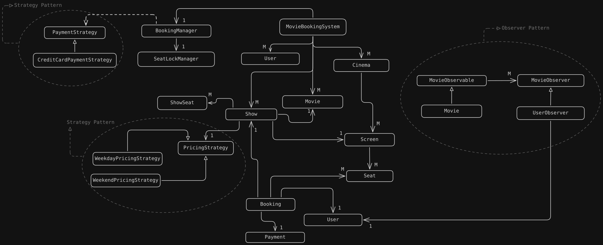
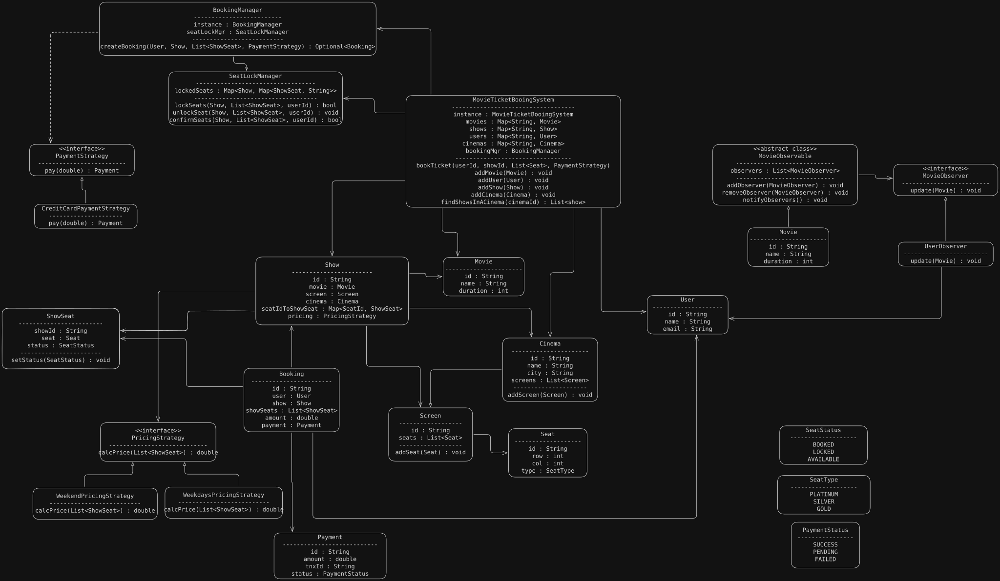

# Requirements

1. **Movie Management:**
    - Store movie information (title, duration, language)
    - Users should be able to browse and search movies.
    - A movie can have multiple shows across different theaters.

2. **Theater Management:**
    - The system should maintain theaters with theater ID, name, and location.
    - Each theater can contain multiple screens.
    - Each screen should contain seats with unique seat IDs, row numbers, seat types, and seat categories.
    - A screen's physical seats should be reusable across multiple shows.

3. **Show Management:**
   - The system should maintain shows with show ID, movie, screen, start time, end time, and pricing strategy.
   - A movie can have multiple shows.
   - A screen can host different shows at different times.

4. **Seat Management:**
   - Users should be able to view available, locked, and booked seats for a particular show.
   - Seat availability must be maintained independently for every show.
   - The same physical seat can be booked for different shows independently.
   - Each seat can be booked by only one user for a particular show.
   - Seats temporarily locked by another user should not be available for booking.

5. **Booking Management**
- Users should be able to select one or multiple seats for a show.
- The system should lock selected seats temporarily before payment.
- A booking should be created with booking ID, user, show, selected seats, amount, and booking status.
- The booking should be confirmed only after successful payment and successful seat confirmation.
- Users should be able to cancel eligible bookings.

6. **Payment Management**
- The system should support payment for a booking.
- Payment should have a unique payment ID, amount, payment method, and payment status.
- A booking should not be confirmed if payment fails.
- The system should handle payment failures and refunds for eligible cancellations.

7. **Seat Locking and Concurrency**
- Multiple users may attempt to book the same seat simultaneously.
- The system must prevent two users from booking the same seat for the same show.
- Seat locking should be atomic for all selected seats.
- Locks should expire automatically after a configured time.
- Only the user who owns a lock should be able to confirm the corresponding seats.
- If a booking fails or the lock expires, the seats should become available again, provided they have not been booked.

8. **Pricing Management**
- The system should calculate the booking amount based on the selected seats.
- Different seat categories may have different prices.
- The system should support extensible pricing strategies, such as weekday and weekend pricing.

# Classes

# UML Diagram
